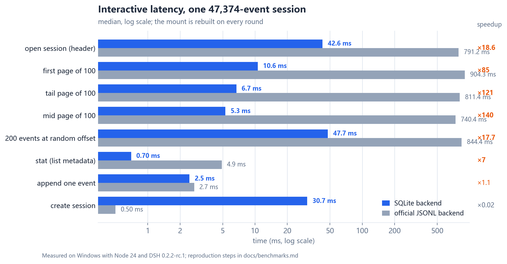

<h1 align="center"> dsh-session-optimizer</h1>

<p align="center"><b>Keep every conversation fluid.</b></p>

<p align="center">A SQLite session store for DeepSeek Harness: faster pages, smaller files, reversible migration.</p>

<p align="center">
  <a href="https://github.com/imuyue/dsh-session-optimizer/releases"></a>
  <a href="LICENSE"></a>
  <a href="package.json"></a>
  <a href="https://github.com/imuyue/dsh-session-optimizer/actions/workflows/ci.yml"></a>
  <a href="package.json"></a>
</p>

<p align="center"><a href="README.md">简体中文</a></p>

<p align="center">
  <a href="#why">Why</a> &middot;
  <a href="#features">Features</a> &middot;
  <a href="#install">Install</a> &middot;
  <a href="#documentation">Documentation</a> &middot;
  <a href="#benchmarks">Benchmarks</a> &middot;
  <a href="#compatibility">Compatibility</a> &middot;
  <a href="#license">License</a> &middot;
  <a href="#acknowledgements">Acknowledgements</a>
</p>

## Why

The official backend stores a conversation as one compressed JSONL artifact. Every mount decompresses and validates the entire artifact, and every page read starts from the beginning of the stream. On a 47,374-event conversation that costs most of a second before a single row appears.



Same conversation, same machine, both backends, median of repeated runs ([full data](docs/en/benchmarks.md)):

| operation            | SQLite  | JSONL    |              |
| -------------------- | ------- | -------- | ------------ |
| open and read header | 42.6 ms | 791.2 ms | 18.6× faster |
| first page of 100    | 10.6 ms | 904.3 ms | 85× faster   |
| last page of 100     | 6.7 ms  | 811.4 ms | 121× faster  |
| page from the middle | 5.3 ms  | 740.4 ms | 140× faster  |
| whole conversation   | 669 ms  | 808 ms   | 1.2× faster  |
| store size           | 24.9 MB | 40.9 MB  | 39% smaller  |

What makes that possible: a header that is read without touching the events, a seal that lets a page be located without decoding the rows it skips, 512 KiB zstd chunks so a page costs one decompress, an 8 MiB frame cache, and a warmup pass after mount.

## Features

dsh-session-optimizer replaces the JSONL session store with a SQLite one, adds a read-only console to the DSH web interface, and ships the command line needed to move existing conversations in and back out.

### Storage

* **One SQLite file per session** — the same directory name encoding and the same session header contract as the official backend, so one profile can run both and pick a backend per conversation.
* **Reads that touch only what they need** — the header lives apart from the events, a seal maps a window onto rows so a page is located without decoding the rows it skips, 512 KiB zstd chunks make a page cost one decompress, an 8 MiB frame cache keeps recent frames decoded, and the five most recent sessions are warmed after mount.
* **Smaller than the artifact it replaces** — chunked storage lands 39% below the compressed JSONL file on the reference conversation.
* **Batched writes** — appends inside a 200 ms window share one transaction, WAL with `synchronous=full`, and the store is created on first write instead of at conversation creation.
* **The host never waits** — every SQLite call runs on a worker thread; the main thread only marshals requests and replies.

### Console

* **Four views in the DSH web interface** — overview (sessions, events, bytes, WAL, damaged stores, effective PRAGMAs, directory permissions), conversation converter, latency, settings.
* **Measured latency, not a guess** — every store call is timed as it happens: p50/p95/p99/max per operation over a five-minute window, journaled every 15 s.
* **Read-only by construction** — the routes open stores with `readOnly: true`, answer only `principal.kind === 'owner'`, and never create a directory or a `-wal` file.

### Moving conversations

* **Two modes in each direction** — overwrite in place (session id kept, the original JSONL moved into `<sourceRoot>.replaced/<migrationId>/`) or copy as a new conversation (new id, original left untouched).
* **Staged, read back, then published** — every migration writes into a staging area, reads every event back and compares it, and only then renames into place, so a crash leaves a visible staging directory instead of a half-written store.
* **A command line that matches** — `import`, `export`, `verify`, `uninstall-check` and `upgrade`, with exit codes 0/1/2.
* **Hybrid routing** — with both backends mounted, a routing table decides where each session lives; a session missing from the expected side is found on the other side and the table heals itself.

### Optional

* **Own search index** — `ownSearch: true` replaces the query provider with a per-store FTS5 index that indexes message text, tool calls and tool output, with CJK bigrams.
* **Long-conversation controls** — bounded read-only previews and an optional page transport for the first follow-up window, both off by default, both switchable in the console. On a 47,377-event conversation the first readable content drops from 3.06 s to 0.37 s with bounded reads on (median of eight ABBA runs).
* **Honest about cost** — [limitations](docs/en/limitations.md) lists what gets slower.

## Install

1. Put the package where your DSH profile resolves plugins (an `npm install` into the profile, or a linked checkout).
2. Add the patches to `profile/cordis.patch.yml`, disabling the official backend:

   ```yaml
   - id: session-persistence
     disabled: true
   - id: session-persistence-sqlite
     module: dsh-session-optimizer
     config:
       root: ~/.dsh/sessions-sqlite
   ```

3. Restart DSH. New conversations are written to `root`; the console appears in the sidebar.

Existing conversations are not moved automatically. Copy them with the command line:

```bash
dsh-session-optimizer import --from ~/.dsh/sessions --to ~/.dsh/sessions-sqlite
dsh-session-optimizer export --from ~/.dsh/sessions-sqlite --to ~/.dsh/sessions   # rollback
dsh-session-optimizer uninstall-check --root ~/.dsh/sessions-sqlite --jsonl ~/.dsh/sessions
```

## Documentation

| document                                  | 中文                                | content                                                                                                           |
| ----------------------------------------- | --------------------------------- | ----------------------------------------------------------------------------------------------------------------- |
| [Architecture](docs/en/architecture.md)   | [架构](docs/architecture.md)        | process structure, on-disk layout, schema, read and write paths, sealing, chunking, worker, lease, hybrid routing |
| [Configuration](docs/en/configuration.md) | [配置](docs/configuration.md)       | every config key, the patch file, console preferences, latency journal, search                                    |
| [CLI](docs/en/cli.md)                     | [命令行](docs/cli.md)                | `import`, `export`, `verify`, `uninstall-check`, `upgrade`                                                        |
| [Console](docs/en/console.md)             | [控制台](docs/console.md)            | HTTP routes, read-only guarantees, views, conversion semantics                                                    |
| [Benchmarks](docs/en/benchmarks.md)       | [基准测试](docs/benchmarks.md)        | both measurement sets, tables and charts, how to reproduce                                                        |
| [Limitations](docs/en/limitations.md)     | [限制](docs/limitations.md)         | cost model, memory, correctness boundaries, platform notes                                                        |
| [Development](docs/en/development.md)     | [开发](docs/development.md)         | build, tests, chart regeneration, conventions                                                                     |

## Benchmarks

Charts are generated from committed CSV data by `benchmarks/plot_results.py`; a self-contained Python reproduction re-measures the three storage shapes without DSH:

```bash
python benchmarks/plot_results.py --lang both
python benchmarks/storage_shape_benchmark.py
```

## Compatibility

| item    | value                                     |
| ------- | ----------------------------------------- |
| DSH     | `>=0.2.2-rc.1`, contract version 4        |
| Node.js | `>=24.9.0`                                |
| formats | reads store layout v1 and v2, writes v2   |

## License

MIT. See [LICENSE](LICENSE).

## Acknowledgements

The architecture, the technical choices and several features were informed by these open source projects. Their licences and copyright notices apply to everything actually reused from them; the contract fixtures under `tests/` are copies of the official `@deepseek-ai/dsh-session*` sources and are used as a test oracle.

**SQLite and storage**

| project                              | reference                                                                    |
| ------------------------------------ | ---------------------------------------------------------------------------- |
| DSH official history SQLite provider | <https://dsh.pub/zh/plugins/session-persistence-sqlite/>                     |
| LangGraph SQLite checkpointer        | <https://github.com/langchain-ai/langgraph/tree/main/libs/checkpoint-sqlite> |
| OpenCode                             | <https://github.com/anomalyco/opencode>                                      |
| hstry                                | <https://github.com/byteowlz/hstry>                                          |
| OpenAI `AdvancedSQLiteSession`       | <https://github.com/openai/openai-agents-python>                             |

**Long-conversation performance and interaction design**

| project                        | reference                                                                                             |
| ------------------------------ | ----------------------------------------------------------------------------------------------------- |
| dsh-large-proj-perf            | <https://github.com/orangeofcarl0-sys/dsh-large-proj-perf>                                            |
| dsh-session-workbench          | <https://github.com/PolinniZhong/dsh-session-workbench>                                               |
| DSH official Session Inspector | <https://github.com/deepseek-ai/deepseek-harness/tree/master/packages/experimental/session-inspector> |

**Testing and feedback**

* [@Aznobin](https://github.com/Aznobin) — testing and feedback.

Thank you to the authors, maintainers and contributors of every project above.

It is your continued exploration, practice and sharing that lets the next project stand on finished work.

Your contribution deserves to be remembered by every user and developer.
