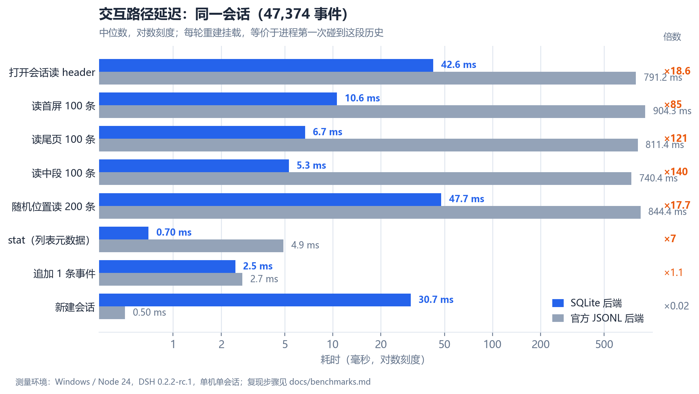

<h1 align="center"> dsh-session-optimizer</h1>

<p align="center"><b>让每一次对话都保持流畅。</b></p>

<p align="center">DeepSeek Harness 的 SQLite 会话存储：翻页更快、占用更小、可回退迁移。</p>

<p align="center">
  <a href="https://github.com/imuyue/dsh-session-optimizer/releases"></a>
  <a href="LICENSE"></a>
  <a href="package.json"></a>
  <a href="package.json"></a>
</p>

<p align="center"><a href="README.en.md">English</a></p>

<p align="center">
  <a href="#为什么">为什么</a> &middot;
  <a href="#特性">特性</a> &middot;
  <a href="#安装">安装</a> &middot;
  <a href="#文档">文档</a> &middot;
  <a href="#基准测试">基准测试</a> &middot;
  <a href="#兼容性">兼容性</a> &middot;
  <a href="#许可">许可</a> &middot;
  <a href="#致谢">致谢</a>
</p>

## 为什么

官方后端把一次对话存成一份压缩的 JSONL 产物。每次挂载都要解压并校验整份产物，每次翻页都要从流的开头读起。在 47,374 个事件的会话上，这意味着一行还没出现就已经花掉近一秒。



同一会话、同一台机器、两个后端，重复测量取中位数（[完整数据](docs/benchmarks.md)）：

| 操作              | SQLite  | JSONL    |            |
| --------------- | ------- | -------- | ---------- |
| 打开并读 header     | 42.6 ms | 791.2 ms | 快 18.6 倍   |
| 首屏 100 条        | 10.6 ms | 904.3 ms | 快 85 倍     |
| 尾页 100 条        | 6.7 ms  | 811.4 ms | 快 121 倍    |
| 中段一页            | 5.3 ms  | 740.4 ms | 快 140 倍    |
| 整段读取            | 669 ms  | 808 ms   | 快 1.2 倍    |
| 存储体积            | 24.9 MB | 40.9 MB  | 小 39%      |

做到这些靠的是：只读 header 就能打开、用封口（seal）在不解码被跳过行的前提下定位一页、512 KiB 的 zstd 分块让一页只需一次解压、8 MiB 帧缓存，以及挂载后的预热。

## 特性

dsh-session-optimizer 把 JSONL 会话存储换成 SQLite，在 DSH Web 界面里加一个只读控制台，并提供把已有对话迁进迁出的命令行。

### 存储

* **一会话一个 SQLite 库** —— 目录名编码与官方后端一致，session header 契约也一致，因此同一个 profile 可以两套后端并存，逐会话选择。
* **只读需要的那一点** —— header 与事件分开存放；封口把窗口映射到行，定位一页时不解码被跳过的行；512 KiB 的 zstd 分块让一页只付一次解压；8 MiB 帧缓存保留刚读过的帧；挂载后还会预热最近五个会话。
* **比它替换掉的产物更小** —— 参考会话上，分块后的库比压缩 JSONL 文件小 39%。
* **写是批量的** —— 200 ms 窗口内的追加共用一个事务，WAL 配 `synchronous=full`，库在首次写入时才建，而不是创建对话时。
* **宿主从不等待** —— 所有 SQLite 调用都跑在 worker 线程，主线程只做请求与应答的编组。

### 控制台

* **DSH Web 界面里的四个视图** —— 总览（会话数、事件数、字节数、WAL、损坏库、生效 PRAGMA、目录权限）、对话转换、延迟、设置。
* **延迟是真测出来的** —— 每次存储调用发生时计时：五分钟窗口内按操作给出 p50/p95/p99/max，每 15 秒落盘一次。
* **结构上就是只读** —— 路由用 `readOnly: true` 打开库，只响应 `principal.kind === 'owner'`，从不创建目录，也不产生 `-wal` 文件。

### 迁移对话

* **两个方向各有两种模式** —— 原位覆盖（session id 不变，原 JSONL 移入 `<sourceRoot>.replaced/<migrationId>/`）或作为新对话复制（新 id，原文件原样保留）。
* **先暂存、再回读、最后发布** —— 每次迁移都先写进暂存区，逐事件回读比对，通过了才 rename 到位；中途崩溃只会留下一个在总览里可见的暂存目录，而不是半个库。
* **配套的命令行** —— `import`、`export`、`verify`、`uninstall-check`、`upgrade`，退出码 0/1/2。
* **混合路由** —— 两套后端同时挂载时，由路由表决定每个会话落在哪边；在预期一侧找不到的会话会去另一侧找，并把路由表修好。

### 可选

* **自建检索索引** —— `ownSearch: true` 时用每个库自带的 FTS5 索引替代官方查询 provider，索引消息正文、工具调用与工具输出，并补上中文二字组。
* **长对话开关** —— 有界只读预览与首屏之后的页传输，两个开关默认关闭，可在控制台里切换。47,377 事件的会话上，开启有界读取后首次可读内容从 3.06 s 降到 0.37 s（八次 ABBA 取中位）。
* **不粉饰成本** —— [已知限制](docs/limitations.md)里写明哪些操作会变慢。

## 安装

1. 把包放到 DSH profile 能解析插件的位置（在 profile 里 `npm install`，或链接本地检出）。

2. 在 `profile/cordis.patch.yml` 里加补丁，关掉官方后端：

   ```yaml
   - id: session-persistence
     disabled: true
   - id: session-persistence-sqlite
     module: dsh-session-optimizer
     config:
       root: ~/.dsh/sessions-sqlite
   ```

3. 重启 DSH。新会话写入 `root`，控制台出现在侧边栏。

已有会话不会自动搬迁，用命令行复制：

```bash
dsh-session-optimizer import --from ~/.dsh/sessions --to ~/.dsh/sessions-sqlite
dsh-session-optimizer export --from ~/.dsh/sessions-sqlite --to ~/.dsh/sessions   # 回滚
dsh-session-optimizer uninstall-check --root ~/.dsh/sessions-sqlite --jsonl ~/.dsh/sessions
```

## 文档

| 文档                                   | English                                   | 内容                                                                       |
| ------------------------------------ | ----------------------------------------- | ------------------------------------------------------------------------ |
| [架构](docs/architecture.md)           | [Architecture](docs/en/architecture.md)   | 进程结构、磁盘布局、表结构、读写路径、封口、分块、worker、租约、混合路由                                  |
| [配置](docs/configuration.md)          | [Configuration](docs/en/configuration.md) | 全部配置键、补丁文件、控制台偏好、延迟日志、检索                                                 |
| [命令行](docs/cli.md)                   | [CLI](docs/en/cli.md)                     | `import`、`export`、`verify`、`uninstall-check`、`upgrade`                   |
| [控制台](docs/console.md)               | [Console](docs/en/console.md)             | HTTP 路由、只读保证、视图、转换语义                                                     |
| [基准测试](docs/benchmarks.md)           | [Benchmarks](docs/en/benchmarks.md)       | 两组测量、表格与图表、复现方法                                                          |
| [限制](docs/limitations.md)            | [Limitations](docs/en/limitations.md)     | 成本模型、内存、正确性边界、平台说明                                                       |
| [开发](docs/development.md)            | [Development](docs/en/development.md)     | 构建、测试、重绘图表、约定                                                            |

## 基准测试

图表由 `benchmarks/plot_results.py` 从已提交的 CSV 生成；另有一份自包含的 Python 复现，不依赖 DSH 重新测量三种存储形态：

```bash
python benchmarks/plot_results.py --lang both
python benchmarks/storage_shape_benchmark.py
```

## 兼容性

| 项目       | 值                          |
| -------- | -------------------------- |
| DSH      | `>=0.2.2-rc.1`，契约版本 4      |
| Node.js  | `>=24.9.0`                 |
| 存储格式     | 可读 v1 与 v2，写入 v2           |

## 许可

MIT，见 [LICENSE](LICENSE)。

## 致谢

本项目的架构设计、技术选型与功能实现，参考并借鉴了以下开源项目。实际复用代码所涉的许可协议与版权声明一律遵守；`tests/` 下的契约夹具是官方 `@deepseek-ai/dsh-session*` 源码的副本，用作测试判定基准。

**SQLite 实现与数据存储**

| 项目                            | 地址                                                                           |
| ----------------------------- | ---------------------------------------------------------------------------- |
| DSH 官方历史 SQLite Provider      | <https://dsh.pub/zh/plugins/session-persistence-sqlite/>                     |
| LangGraph SQLite Checkpointer | <https://github.com/langchain-ai/langgraph/tree/main/libs/checkpoint-sqlite> |
| OpenCode                      | <https://github.com/anomalyco/opencode>                                      |
| hstry                         | <https://github.com/byteowlz/hstry>                                          |
| OpenAI AdvancedSQLiteSession  | <https://github.com/openai/openai-agents-python>                             |

**长对话性能优化与交互设计**

| 项目                         | 地址                                                                                                    |
| -------------------------- | ----------------------------------------------------------------------------------------------------- |
| dsh-large-proj-perf        | <https://github.com/orangeofcarl0-sys/dsh-large-proj-perf>                                            |
| dsh-session-workbench      | <https://github.com/PolinniZhong/dsh-session-workbench>                                               |
| DSH 官方 Session Inspector   | <https://github.com/deepseek-ai/deepseek-harness/tree/master/packages/experimental/session-inspector> |

**测试与反馈**

* [@Aznobin](https://github.com/Aznobin) —— 测试与反馈。

本项目诚挚感谢以上所有开源项目的作者、维护者以及贡献者。

正是你们持续不断的探索、实践与分享，让后来者能够站在已有成果之上继续前进。

你们的贡献值得被每一位用户和开发者铭记于心！
