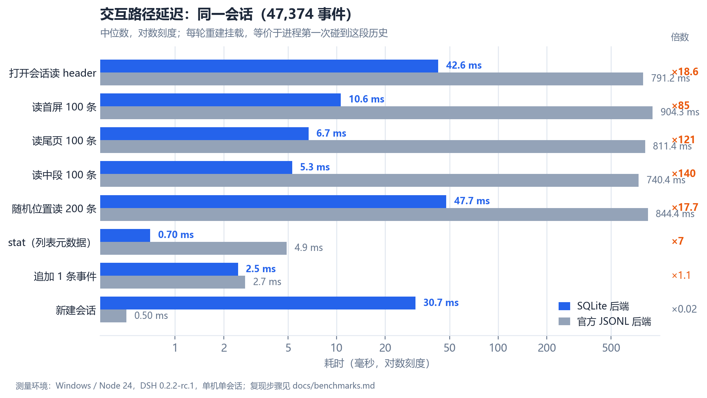
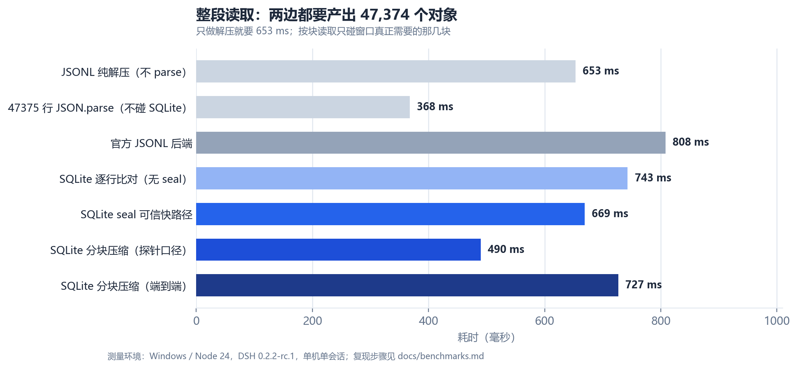
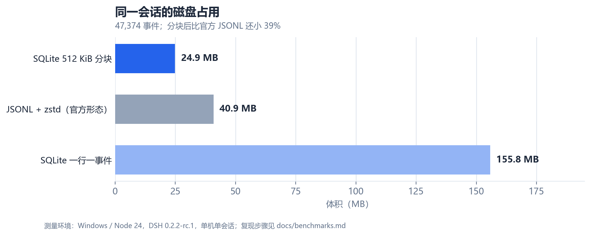
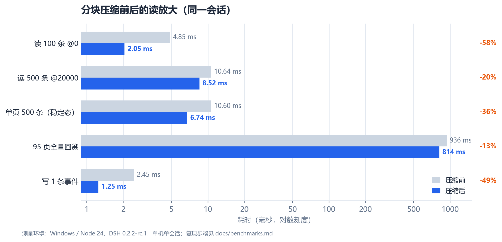
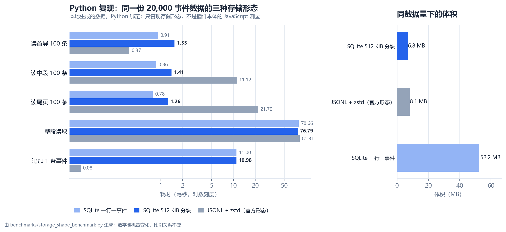

# 基准测试

> English: [docs/en/benchmarks.md](en/benchmarks.md)

<!-- docs-nav -->
[文档](../README.md#文档) · [架构](architecture.md) · [配置](configuration.md) · [命令行](cli.md) · [控制台](console.md) · **基准测试** · [限制](limitations.md) · [开发](development.md)

这里有两组互相独立的数字：

1. **插件内实测** —— 同一个真实会话、两个后端、同一台机器、同一批操作。数据在 [`benchmarks/data/`](../benchmarks/data)。设计决策就是拿这些数字对出来的。
2. **Python 复现** —— 没有 DSH、没有 JavaScript：同一份数据按三种存储形态写入，用标准库计时。数据在 [`benchmarks/data/storage-shape-*.csv`](../benchmarks/data)。它只反映存储形态本身，插件自身开销无法给结果加分。

## 参考测量

| 项目 | 值 |
| --- | --- |
| 会话 | 47,374 个事件 |
| SQLite 文件 | 未压缩 155.8 MB，分块后 24.9 MB |
| 官方 JSONL 文件 | 40.9 MB（`session.v4.jsonl.zstd`） |
| 环境 | Windows 11、Node 24、DSH 0.2.2-rc.1，单机单会话 |
| 方法 | 每次重建挂载、执行操作、重复取中位数 |

### 交互路径



| 操作 | SQLite（ms） | JSONL（ms） | 比值 |
| --- | --- | --- | --- |
| 打开读 header | 42.6 | 791.2 | 0.05× |
| 首屏 100 条 | 10.6 | 904.3 | 0.012× |
| 尾页 100 条 | 6.7 | 811.4 | 0.008× |
| 中段 100 条 | 5.3 | 740.4 | 0.007× |
| 随机 200 条 | 47.7 | 844.4 | 0.056× |
| stat | 0.7 | 4.9 | 0.14× |
| 追加 1 条事件 | 2.45 | 2.71 | 0.90× |
| 新建会话 | 30.7 | 0.5 | 61× |

有两行需要解释。JSONL 侧「打开读 header」要 791ms，是因为官方 provider 必须先完整加载并校验整份产物才能作答；这份成本也摊在其余每一行 JSONL 数据下面。「新建会话」是 JSONL 唯一胜出的操作：建一个 SQLite 会话要写库，而 JSONL 后端只是打开一个文件。

### 整段读取



| 实现 | ms | 说明 |
| --- | --- | --- |
| JSONL，冷挂载 | 808 | 多次测量 743–905 |
| SQLite，无封口 | 743 | 逐行解码 |
| SQLite，有封口 | 669 | 键折叠 + `decodeTrusted` |
| SQLite，分块 | 490 | 探针：解压 283 + parse 287 |
| SQLite，分块端到端 | 727 | 含帧管理开销 |
| JSONL，只做 zstd 解压 | 653 | 不解析 JSON |
| JSONL，只做 JSON.parse | 368 | 已解压 |

整段读是数据库赢得最少的操作：载荷是同一批字节，能省的只有 WAL 重放与冗余列。而它上面的每一个操作都轻松胜出，因为那些路径根本不碰整个文件。

换一个更大的真实会话（56,537 事件、84 MB 压缩存储、平均每事件约 3.9 KB JSON）测同一件事，得到的是**每事件 24.4µs**、整段 1377ms、峰值堆 312MB；参考会话是每事件 14.1µs。所以上面的绝对毫秒数不能跨会话比较，跨会话要比**每事件成本**与**吞吐（MB/s）**：同样是整段读，事件越小、会话越大，单事件成本越低，而总量永远随字节数线性增长。

### 体积



| 形态 | MB |
| --- | --- |
| SQLite，一行一事件 | 155.8 |
| 官方 JSONL | 40.9 |
| SQLite，512 KiB 分块 | 24.9 |

一行一事件除同样 JSON 外还存行号与类型，因此比官方压缩产物更大。同一批文本按 512 KiB 做 zstd 分块后比官方编码更小，因为帧更大、header 不重复。

### 分块与帧缓存



| 操作 | 前（ms） | 后（ms） |
| --- | --- | --- |
| 首屏 100 事件 | 4.85 | 2.05 |
| 偏移 20,000 处读 500 事件 | 10.64 | 8.52 |
| 单页稳定态 | 10.60 | 6.74 |
| 95 页回溯 | 936 | 814 |
| 追加 1 条事件 | 2.45 | 1.25 |

帧缓存常驻 8 块时，同一段 95 页回溯只需 269 次解码（原 445 次），951ms 降到 637ms。

一次**整段**读取还受页传输格式影响。此前每页在 worker 里切成字符串数组、`join` 回整串、`TextEncoder` 编码、跨线程、`TextDecoder` 解码、再 `split` 回数组——这一圈在 47k 事件上占 1296ms 里的 405ms（31%）。现在整段读取直接要 `'lines'`，页以字符串交出，省掉整圈；`zstdDecompressSync` 也直接吃 `Uint8Array`，不再为每帧复制一份 payload。对外的 `readPage` 仍按协商格式返回，因为客户端可能自己驱动分页。

| 环境 | 改前（bytes） | 改后（lines） | 变化 |
| --- | --- | --- | --- |
| 真机 · 56,537 事件 · 83.9MB | 1428–1691ms | 962–983ms | −32.6% |
| 真机 · 合成 20,000 事件 | 265–274ms | 182–194ms | −31.3% |
| vm_linux · 2 vCPU · 合成 20,000 | 239–317ms | 145–166ms | −39.3% |
| vm_windows · 合成 20,000 | 275–304ms | 203–219ms | −26.2% |

四组的事件内容逐字节相同：`repro/52-s1-s2-verify.mjs` 对全量事件取 sha256 与逐行读比对，不只看条数。

## Python 复现

```bash
python benchmarks/storage_shape_benchmark.py
python benchmarks/plot_results.py --lang both
```

`storage_shape_benchmark.py` 把同一份 20,000 事件载荷按三种方式写入，并对五个操作各取 5 次中位数：

* `jsonl_zstd` —— 多帧 zstd 流，每帧 64 事件，首行是 header（官方形态）；
* `sqlite_plain` —— 一行一事件加 `storage_meta`；
* `sqlite_chunked` —— 一行一事件压缩成 512 KiB zstd 块加尾行（本插件收敛到的形态），读窗口时不启用帧缓存，取值偏保守。



| 操作 | jsonl_zstd（ms） | sqlite_plain（ms） | sqlite_chunked（ms） |
| --- | --- | --- | --- |
| 读首屏 100 条 | 0.37 | 0.91 | 1.55 |
| 读中段 100 条 | 11.12 | 0.86 | 1.41 |
| 读尾页 100 条 | 21.70 | 0.78 | 1.26 |
| 整段读取 | 81.31 | 78.66 | 76.79 |
| 追加 1 条事件 | 0.08 | 11.00 | 10.98 |

| 形态 | MB |
| --- | --- |
| jsonl_zstd | 8.07 |
| sqlite_plain | 52.25 |
| sqlite_chunked | 6.83 |

这次复现对自己没有建模的部分是诚实的：20,000 事件不大，页缓存是热的，每次 Python 调用都是进程内的单次操作，没有 provider 的簿记成本。所以首屏读看起来是 JSONL 最好——往流末追加一帧几乎不花钱，而数据库要打开、寻址、读取。插件在参考测量里的优势来自另一个方向：官方 provider 每次挂载都要付整份产物的成本，数据库不必。两种视角都保留在这里。

## 复现方式

```bash
# 参考测量（需要 DSH profile 与一个大会话）
python benchmarks/plot_results.py --lang both     # 只出图，数据来自已提交的 CSV

# 存储形态复现（需要 Python 3 与 zstandard、matplotlib）
python benchmarks/storage_shape_benchmark.py
```

`plot_results.py` 为两种语言各生成 `docs/images/<chart>.<lang>.{png,svg}`，它自身从不跑基准，只读已提交的 CSV，因此在没有 DSH 的机器上也能重画图表。
