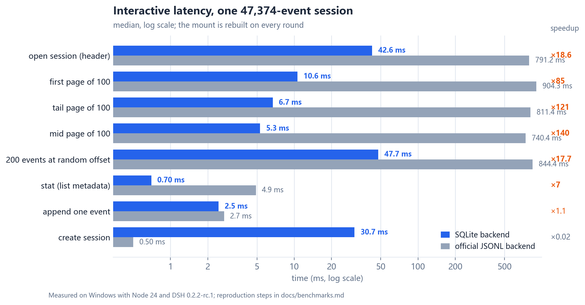
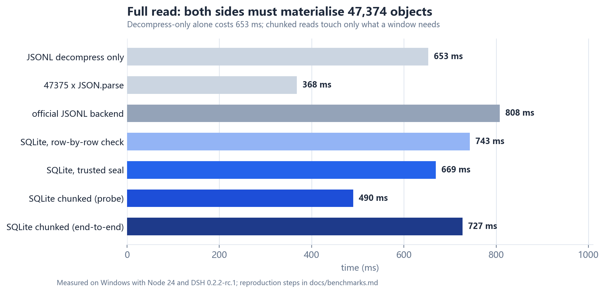
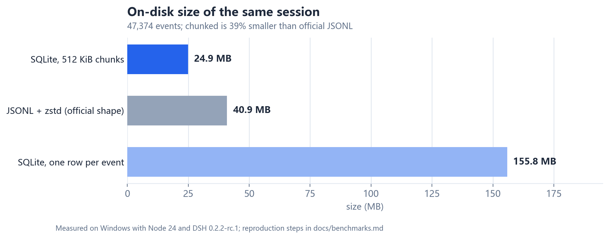
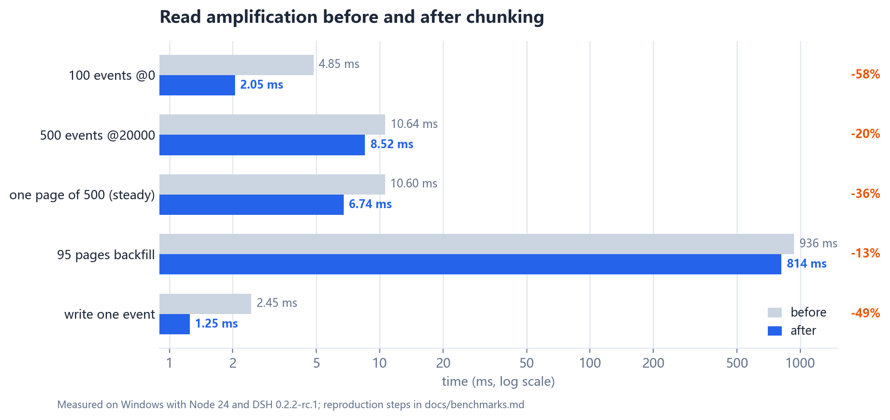
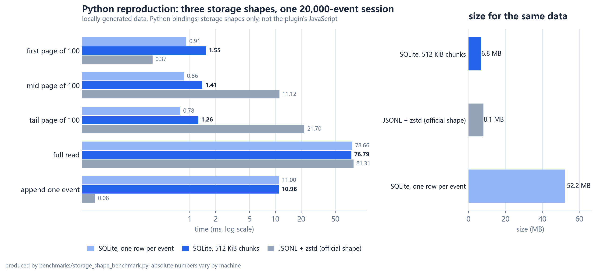

# Benchmarks

> 简体中文：[docs/benchmarks.md](../benchmarks.md)

<!-- docs-nav -->
[Docs](../../README.en.md#documentation) · [Architecture](architecture.md) · [Configuration](configuration.md) · [CLI](cli.md) · [Console](console.md) · **Benchmarks** · [Limitations](limitations.md) · [Development](development.md)

Two independent sets of numbers live here:

1. **Measured in the plugin** — one real conversation, both backends, same machine, the same operations. Data: [`benchmarks/data/`](../../benchmarks/data). These are the numbers the design decisions were made against.
2. **Reproduced in Python** — no DSH, no JavaScript: the same data written in three storage shapes and timed with the standard library. Data: [`benchmarks/data/storage-shape-*.csv`](../../benchmarks/data). These show the storage shape alone, so the plugin's own overhead cannot flatter the result.

## Reference measurement

| item | value |
| --- | --- |
| conversation | 47,374 events |
| SQLite file | 155.8 MB uncompressed, 24.9 MB after chunking |
| official JSONL file | 40.9 MB (`session.v4.jsonl.zstd`) |
| host | Windows 11, Node 24, DSH 0.2.2-rc.1, single machine, single session |
| method | mount fresh, run the operation, median of repeated runs |

### Interactive operations



| operation | SQLite (ms) | JSONL (ms) | ratio |
| --- | --- | --- | --- |
| open header | 42.6 | 791.2 | 0.05× |
| first page (100) | 10.6 | 904.3 | 0.012× |
| tail page (100) | 6.7 | 811.4 | 0.008× |
| middle page (100) | 5.3 | 740.4 | 0.007× |
| random 200 events | 47.7 | 844.4 | 0.056× |
| stat | 0.7 | 4.9 | 0.14× |
| append one event | 2.45 | 2.71 | 0.90× |
| create session | 30.7 | 0.5 | 61× |

Two entries deserve a note. `open header` on the JSONL side costs 791 ms because the official provider loads and validates the whole artifact before it can answer; that cost also lands under every other JSONL row. `create` is the one operation where the JSONL backend wins: creating a SQLite session writes a database, while the JSONL backend only opens a file.

### Whole-conversation reads



| implementation | ms | note |
| --- | --- | --- |
| JSONL, cold mount | 808 | 743–905 across runs |
| SQLite, no seal | 743 | row-by-row decode |
| SQLite, sealed | 669 | key-only fold, `decodeTrusted` |
| SQLite, chunked | 490 | probe: 283 decompress + 287 parse |
| SQLite, chunked end to end | 727 | includes frame bookkeeping |
| JSONL, zstd decompress only | 653 | no JSON parse |
| JSONL, JSON parse only | 368 | already decompressed |

A full read is the operation where a database wins least: the payload is the same bytes, so the only saving is skipping the WAL replay and the redundant columns. Everything above cheaply beats it, because those paths never touch the whole file.

### Space



| shape | MB |
| --- | --- |
| SQLite, one row per event | 155.8 |
| official JSONL | 40.9 |
| SQLite, 512 KiB chunks | 24.9 |

Per-event rows store the same JSON plus a row id and a type, so they are larger than the official compressed artifact. 512 KiB zstd chunks of the same text are smaller than the official encoding, because the frame size is larger and the header duplicates nothing.

### Chunking and the frame cache



| operation | before (ms) | after (ms) |
| --- | --- | --- |
| first 100 events | 4.85 | 2.05 |
| 500 events at offset 20,000 | 10.64 | 8.52 |
| single page, steady state | 10.60 | 6.74 |
| 95-page backfill | 936 | 814 |
| append one event | 2.45 | 1.25 |

With 8 chunks resident in the frame cache, the same 95-page backfill needs 269 decodes instead of 445 and drops from 951 ms to 637 ms.

## Python reproduction

```bash
python benchmarks/storage_shape_benchmark.py
python benchmarks/plot_results.py --lang both
```

`storage_shape_benchmark.py` builds the same 20,000-event payload three ways and times five operations with `median of 5`:

* `jsonl_zstd` — multi-frame zstd stream, 64 events per frame, header line first (the official shape);
* `sqlite_plain` — one row per event plus `storage_meta`;
* `sqlite_chunked` — one row per event compacted into 512 KiB zstd chunks plus a tail (the shape this plugin converges to), read without a frame cache to stay conservative.



| operation | jsonl_zstd (ms) | sqlite_plain (ms) | sqlite_chunked (ms) |
| --- | --- | --- | --- |
| first 100 events | 0.37 | 0.91 | 1.55 |
| 100 events in the middle | 11.12 | 0.86 | 1.41 |
| last 100 events | 21.70 | 0.78 | 1.26 |
| full read | 81.31 | 78.66 | 76.79 |
| append one event | 0.08 | 11.00 | 10.98 |

| shape | MB |
| --- | --- |
| jsonl_zstd | 8.07 |
| sqlite_plain | 52.25 |
| sqlite_chunked | 6.83 |

This run is honest about what it does not model: a 20,000-event payload is small, the recorded L3 cache is warm, and each Python call is a fresh process-level operation with no provider bookkeeping. That is why the first page looks best for JSONL — appending a frame to a stream is trivially cheap, while a database must open, seek and read. The plugin's advantage in the reference measurement comes from the other direction: the official provider pays a full-artifact cost on every mount, and a database does not. Both views are kept here on purpose.

## Reproducing

```bash
# reference measurement (needs a DSH profile and a large conversation)
python benchmarks/plot_results.py --lang both     # charts only, from the committed CSV

# storage-shape reproduction (needs Python 3 with zstandard and matplotlib)
python benchmarks/storage_shape_benchmark.py
```

`plot_results.py` writes `docs/images/<chart>.<lang>.{png,svg}` for both languages and never runs a benchmark itself — it reads the committed CSV files, so the charts can be regenerated without a DSH installation.
